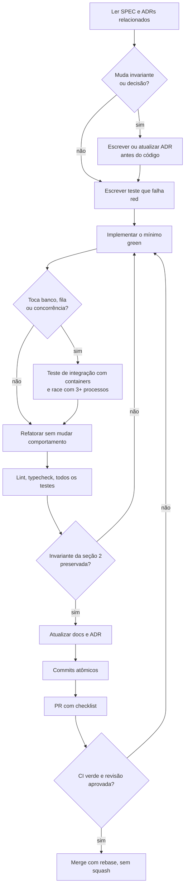

# AGENTS.md: Distributed Wagering Processor

Contrato operacional para qualquer agente (humano ou IA) que alterar este repositório.
Em caso de conflito, a ordem de precedência é: **(1)** `docs/REGRAS-DE-NEGOCIO.md`, para regra de negócio; **(2)** invariantes da seção 2 deste arquivo; **(3)** `docs/SPEC.md`; **(4)** ADRs em `docs/adr/`; **(5)** pedido da sessão. Um pedido nunca enfraquece as invariantes; se conflitar, pare e reporte.

---

## 1. Objetivo

Serviço financeiro distribuído que processa apostas de provedores de jogos com correção contábil absoluta, concorrência serializada por `walletId`, idempotência persistente e recuperação após falhas de infraestrutura.

Stack obrigatória: Bun 1.x, TypeScript estrito, NestJS, MikroORM (preferencial), PostgreSQL, AWS SQS FIFO via LocalStack ou MiniStack, Docker Compose, migrations versionadas e reversíveis.

---

## 2. Invariantes não negociáveis

Violação de qualquer item bloqueia o merge.

1. **Dinheiro nunca é `number`, `float` ou `double`.** `Money` usa string decimal de escala 2 e aritmética exata.
2. **`Money` rejeita, não arredonda:** `NaN`, `Infinity`, notação científica, string vazia, mais de 2 casas e negativos em entrada.
3. **Idempotência é persistida no PostgreSQL.** Cache em memória nunca é garantia.
4. **O banco é a fonte da verdade.** Unicidade, não-negatividade e imutabilidade vivem no schema (`UNIQUE`, `CHECK`, índice parcial, trigger), não só no código.
5. **Concorrência por `walletId`, com lock de linha.** Lock global é proibido.
6. **Nenhum saldo é `read → calculate → write` sem lock ou CAS.**
7. **Evento só é publicado após o commit**, gravado no outbox na mesma transação.
8. **Ledger é append-only.** Nenhuma linha é atualizada ou removida (trigger no banco).
9. **Corretude com múltiplas instâncias.** Qualquer teste de concorrência roda com 3 ou mais processos.
10. **Testes de integração usam PostgreSQL e LocalStack/MiniStack reais em containers.** Mock de banco ou fila só é aceito em teste unitário de lógica pura.
11. **Domínio (`src/domain/`) não importa NestJS, MikroORM, SQS ou qualquer framework.**
12. **Workers criam `em.fork()` por iteração ou mensagem.** O Identity Map nunca cresce entre iterações.
13. **Reversão única por referência**, independente do `kind` (`REFUND` e `ROLLBACK` do mesmo `BET` são mutuamente exclusivos). Desvio intencional e documentado de RN-16 em relação ao enunciado §7, regra 4.
14. **Replay retorna o snapshot da época** (`resulting_balance` gravado na transação), nunca o saldo atual.
15. **`WalletBalanceChanged` só é emitido quando o saldo muda.**

---

## 3. Arquitetura por camadas

| Camada | Caminho | Pode importar | Não pode importar |
|---|---|---|---|
| Domínio | `src/domain/` | TypeScript puro, `Money` | NestJS, MikroORM, SQS, `pg` |
| Aplicação | `src/application/` | Domínio, portas (interfaces) | Adapters concretos, HTTP, SQS |
| Persistência | `src/infrastructure/persistence/` | ORM, domínio via mappers | Controllers |
| Mensageria | `src/infrastructure/messaging/` | SDK SQS, aplicação | Regra de negócio |
| Interface | `src/interfaces/` | Aplicação, DTOs | Persistência direta |
| Workers | `src/infrastructure/workers/` | Aplicação, `forkEm` | Regra de negócio fora do caso de uso |

Mappers em `persistence/mappers/` convertem `*OrmEntity.ts` ↔ domínio. Nenhum tipo do ORM cruza essa fronteira.

---

## 4. Fluxo de referência (resumo; detalhe em `docs/SPEC.md`)

**Entrada:** HTTP ou SQS chegam ao **mesmo** caso de uso `ProcessWagerTransaction`.

1. Valida payload. Inválido: 400 (HTTP) ou DLQ (SQS).
2. Calcula `payloadHash` (SHA-256 de JSON canônico, chaves ordenadas, sem headers).
3. **Fast-path sem lock:** se a chave ou o par `(provider_id, external_transaction_id)` já existe em estado terminal (`PROCESSED` ou `REJECTED`), compara chave e hash. Hash igual: replay (RN-20), sem abrir escrita. Hash diferente: 409 (RN-21). Chave diferente para o mesmo par: 409 (RN-22).
4. **Slow-path:** transação SQL com `SET LOCAL lock_timeout = '3000ms'`, `SELECT ... FOR UPDATE` na wallet e busca idempotente de novo sob o lock.
5. Conflito de hash ou de chave: 409. Mesma chave com `PENDING_REFERENCE`: 202.
6. Domínio aplica o efeito ou produz rejeição com `failureCode`. **Rejeição é resultado persistido, não exceção.**
7. Na mesma transação: `wager_transactions` (com `resulting_balance`), `wallets` (com CAS por `version`), `wallet_ledger_entries` (se o saldo mudou), `inbox_messages` (se veio da fila), `outbox_messages`.
8. COMMIT. Só depois: resposta HTTP ou ack SQS.
9. `23505` → ROLLBACK, `em.fork()`, busca a linha commitada, valida hash e responde replay ou 409. Nunca 500.
10. Transitórios (`55P03`, `40P01`, `40001`, timeout) → 503 com `Retry-After` (HTTP) ou throw sem ack (SQS).

**Pendências:** referência ausente vira `PENDING_REFERENCE`. Worker com backoff exponencial (base 2 s, fator 2, teto 5 min, jitter ±20%), limite de 12 tentativas ou TTL de 24 h. Transição para `PROCESSED` que receba `23505` vira `REJECTED` com `REFERENCE_ALREADY_REVERSED`, em transação nova, sem retry.

---

## 5. Fluxograma de cada ciclo de trabalho

Todo ciclo (uma tarefa, uma fase ou um incidente) passa por estas etapas, nesta ordem.



### Justificativa das escolhas do ciclo

| Escolha | Por quê |
|---|---|
| ADR antes do código | Decisão de correção financeira precisa ser auditável antes de virar código. Evita que o código decida em silêncio. |
| Teste vermelho primeiro | Prova que o teste detecta a falha. Um teste escrito depois do código tende a validar o que o código já faz. |
| Integração com containers para banco e fila | Race condition e constraint só aparecem com PostgreSQL e SQS reais. Mock esconde exatamente os defeitos que importam. |
| Refatoração separada da mudança de comportamento | Commits que mudam comportamento e estrutura ao mesmo tempo são impossíveis de revisar e de reverter com segurança. |
| Checklist de invariantes antes do merge | As invariantes são o contrato do sistema. Revisão humana tende a deixar passar a que não está no diff. |
| Merge com rebase | Preserva commits atômicos na `main`, o que torna `git bisect` e `git blame` úteis em incidente financeiro. |

---

## 6. Convenções de git

### Branches
- `main` protegida: exige PR, CI verde e revisão.
- Nome: `tipo/fase-NN-assunto`, por exemplo `feat/fase-02-money`, `fix/fase-09-outbox-advisory-lock`.
- Uma branch por fase ou tarefa. Sem branches de semanas.

### Commits (Conventional Commits)
Formato: `tipo(escopo): descrição no imperativo, até 72 caracteres`.

- Tipos: `feat`, `fix`, `refactor`, `test`, `perf`, `docs`, `build`, `ci`, `chore`, `db` (migrations e constraints).
- Escopos: `domain`, `application`, `persistence`, `messaging`, `interfaces`, `workers`, `observability`, `infra`, `docs`, `schema`, `integration`, `concurrency`, `redteam`, `load`.
- Quebra de compatibilidade: `!` após o escopo e linha `BREAKING CHANGE:` no corpo.
- Corpo: explica o porquê e cita a invariante ou ADR afetada, por exemplo `Refs: ADR-0004, seção 2.13`.

Regras:
1. Cada commit compila, passa em lint e nos testes. Não existe commit quebrado no meio do histórico.
2. Commit de comportamento e commit de refatoração são separados.
3. Migration nunca é editada depois de mergeada. Correção vira nova migration.
4. Mudança de schema sempre vem com teste de constraint.
5. Mensagem de fix financeiro cita o cenário reproduzido pelo teste.
6. Commit ou teste que implementa uma regra cita o identificador `RN-NN` de `docs/REGRAS-DE-NEGOCIO.md`.

Exemplo:
```
db(persistence): adiciona índice parcial de reversão única

Impede REFUND e ROLLBACK processados sobre a mesma referência,
independente do kind. Sem isso, uma aposta de 25,00 pode gerar
crédito de 50,00.

Refs: ADR-0004, seção 2.13
```

### Tags e releases
- Uma tag por fase concluída: `v0.<fase>.0`.
- `CHANGELOG.md` gerado a partir dos commits.

### Pré-commit e CI
- Hooks locais: formatação, lint e typecheck dos arquivos alterados.
- CI (GitHub Actions) em estágios separados: `lint` → `typecheck` → `unit` → `integration` (sobe PostgreSQL e LocalStack em service containers) → `concurrency` (3 processos).
- O estágio `concurrency` é obrigatório para qualquer PR que toque `persistence`, `application`, `workers` ou `messaging`.

---

## 7. Estrutura do repositório

```
.
├── AGENTS.md
├── CLAUDE.md
├── README.md
├── ARCHITECTURE.md
├── CHANGELOG.md
├── docker-compose.yml
├── docs/
│   ├── REGRAS-DE-NEGOCIO.md    fonte única das regras (RN-NN)
│   ├── SPEC.md                 arquitetura, fluxos e contratos
│   ├── RED-TEAM.md             procedimento de mutation testing
│   ├── adr/                    NNNN-titulo.md (Michael Nygard)
│   └── diagrams/
├── migrations/                 versionadas, com up e down
├── src/
│   ├── domain/
│   ├── application/
│   ├── infrastructure/
│   │   ├── persistence/
│   │   ├── messaging/
│   │   └── workers/
│   ├── interfaces/
│   └── observability/
└── test/
    ├── unit/
    ├── integration/
    ├── concurrency/
    └── helpers/                containers, fábricas, relógio controlado
```

---

## 8. ADRs

Toda decisão que altera correção, concorrência, schema, mensageria ou contrato público vira ADR.

Formato obrigatório:
- **Contexto:** problema e restrições.
- **Decisão:** o que foi escolhido.
- **Alternativas consideradas:** pelo menos duas, com motivo da rejeição.
- **Consequências:** ganhos, custos e riscos residuais.
- **Verificação:** qual teste prova a decisão.

ADRs iniciais que devem existir antes da Fase 1:
- ADR-0001: ORM (MikroORM) e estratégia transacional.
- ADR-0002: representação de `Money` (string decimal + NUMERIC(19,2)).
- ADR-0003: lock pessimista por wallet com `lock_timeout`, e CAS por `version` como segunda barreira.
- ADR-0004: reversão única por referência, sem `kind` no índice. Registra o desvio de RN-16 em relação ao enunciado §7, regra 4, com a justificativa da dupla creditação.
- ADR-0005: idempotência com fast-path terminal (com comparação de hash) e slow-path sob lock.
- ADR-0006: outbox com publisher por agregado: advisory lock, pendente mais antigo sem filtro de `next_attempt_at`, e teste de ordem.
- ADR-0007: taxonomia de erros e mapeamento HTTP.
- ADR-0008: autenticação (implementar ou não, com o ponto de extensão).

---

## 9. Testes: definição mínima

| Tipo | O que prova | Ferramenta |
|---|---|---|
| Unitário | Regras de `Money`, `Wallet`, `WagerTransaction`, referência de 5 vias | `bun test` |
| Integração | Constraints, trigger, atomicidade wallet/ledger/inbox/outbox, redelivery, retry, DLQ | `bun test` + containers |
| Concorrência | 50 apostas iguais em paralelo → 1 débito; 2 × 80,00 com saldo 100,00; 3+ processos; worker morto após commit | `bun test` + processos reais |
| Caos | Kill entre commit e ack; `lock_timeout`; PostgreSQL indisponível; reinício | script com `docker stop` |

Invariante final de todo teste: `wallet.balance == saldo reconstruído pelo ledger`.

Teste que substitui PostgreSQL ou SQS por mock em integração é rejeitado no review.

---

## 10. Observabilidade

- Logs JSON com `correlationId`, `messageId`, `transactionId`, `walletId`, `providerId`.
- Nunca logar payload financeiro completo.
- Métricas mínimas: transações por status, duplicatas, retries, DLQ, conflitos de lock, outbox lag, latência de processamento.
- `/health/live` e `/health/ready` sem autenticação. `ready` verifica PostgreSQL e SQS.

---

## 11. Definition of Done

Uma tarefa só está concluída quando:

- [ ] ADR criado ou atualizado, se a tarefa altera decisão.
- [ ] Testes escritos antes, com registro de que falharam antes da implementação.
- [ ] Lint, typecheck e todos os testes verdes localmente e no CI.
- [ ] Invariantes da seção 2 verificadas e citadas na descrição do PR.
- [ ] Migration com `up` e `down` testados.
- [ ] Nenhum `number` em valor monetário.
- [ ] Logs sem dados sensíveis.
- [ ] Commits atômicos seguindo a seção 6.
- [ ] `docs/SPEC.md` e README atualizados se o comportamento mudou.

---

## 12. Proibido para agentes

- Alterar uma invariante da seção 2 sem ADR aprovado.
- Afrouxar uma constraint do banco para fazer um teste passar.
- Editar migration já mergeada.
- Desligar `strict` do TypeScript ou usar `any` em domínio ou persistência.
- Silenciar erro financeiro com `catch` genérico.
- Commitar `.env`, segredos ou dados reais de jogador.
- Marcar teste como `skip` sem issue associada.
- Declarar desempenho ("~1 ms", "p99 de X") sem medição reproduzível no repositório.

---

## 13. Correções pendentes conhecidas

- **Publisher do outbox (SPEC, seção 11.3):** a versão anterior filtrava `next_attempt_at` antes de ordenar, e assim publicava um evento posterior antes de um anterior em backoff. Também usava `hashtext(uuid)`, que não existe no PostgreSQL. Correção descrita na SPEC; a ordem é provada pelo teste do ciclo C09 (P09.4) e registrada na ADR-0006.
- **ADR-0004:** precisa registrar o desvio de RN-16 em relação ao enunciado §7, regra 4.
- **Medições de desempenho:** nenhuma foi feita. Não citar números sem benchmark reproduzível.

Esta seção deve ser apagada quando as correções estiverem aplicadas e testadas.
