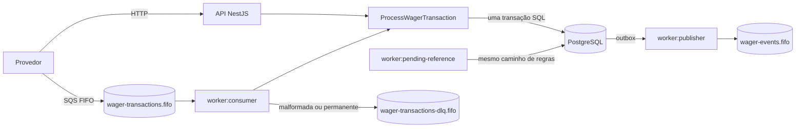

# Arquitetura

Este documento resume como o serviço é organizado, quais decisões o sustentam e o que ele não faz.

As regras de negócio estão em [docs/REGRAS-DE-NEGOCIO.md](docs/REGRAS-DE-NEGOCIO.md) e são citadas como RN-NN. Os fluxos e o schema estão em [docs/SPEC.md](docs/SPEC.md), e as decisões em [docs/adr/](docs/adr/). Este documento não repete regra: aponta para ela.

## Visão geral

**Componentes:**
- **API HTTP e consumer SQS:** são as duas entradas e chamam o mesmo caso de uso, `ProcessWagerTransaction` (SPEC 5).
- **Caso de uso:**
  - valida a entrada;
  - responde replay de estado terminal sem lock;
  - trava a wallet;
  - aplica o efeito ou grava a rejeição como resultado.
- **Mesma transação SQL:** a transação, a wallet, o ledger, a inbox (quando veio da fila) e o outbox são gravados juntos.
- **Resolvedor de pendências:** reprocessa `PENDING_REFERENCE` pelo mesmo caminho de regras (SPEC 8).
- **Publisher:** envia o outbox para a fila de eventos, só depois do commit (SPEC 11.3).

**O PostgreSQL é a fonte da verdade.** Unicidade, não-negatividade, imutabilidade do ledger e do status terminal estão no schema, com `UNIQUE`, `CHECK`, índices parciais e triggers (SPEC 12). O código não é a única barreira.

### Camadas

| Camada | Caminho | Responsabilidade |
|---|---|---|
| Domínio | `src/domain/` | `Money`, `Wallet`, `WagerTransaction`, regras de referência, backoff. TypeScript puro |
| Aplicação | `src/application/` | Casos de uso e portas: `UnitOfWork`, repositórios, relógio |
| Persistência | `src/infrastructure/persistence/` | MikroORM, mappers, repositórios, tradução de erros do driver |
| Mensageria | `src/infrastructure/messaging/` | Cliente SQS, consumer, publisher, filas |
| Workers | `src/infrastructure/workers/` | Processos `*.main.ts` e o loop do resolvedor |
| Interface | `src/interfaces/http/` | Controllers, filtro de erros, guard de autenticação, health |

As regras de importação entre camadas estão no AGENTS.md §3, e o guard `domain-imports` confere a do domínio.

## Diagramas

| Diagrama | Conteúdo |
|---|---|
| [Componentes](docs/diagrams/componentes.md) | API, workers, filas SQS e PostgreSQL, com o tipo de comunicação em cada seta |
| [Fluxo de uma BET pela API](docs/diagrams/fluxo-aposta.md) | Sequência da aposta até o COMMIT, e a publicação do evento pelo `worker:publisher` depois dele |
| [Estados de WagerTransaction](docs/diagrams/estados-transacao.md) | Estados e transições do mapa `TRANSITIONS`, com os estados terminais |

Cada arquivo indica onde cada seta ou transição está no código e lista o que difere da descrição original.

## Índice das ADRs

| ADR | Status | Decisão |
|---|---|---|
| [0001](docs/adr/0001-orm-mikroorm-e-estrategia-transacional.md) | aceita | MikroORM com PostgreSQL. Cada caso de uso é uma transação SQL pela porta `UnitOfWork`, com `em.fork()` por execução |
| [0002](docs/adr/0002-money-string-decimal-e-numeric.md) | aceita | `Money` como string decimal de escala 2, aritmética em centavos `bigint` e `NUMERIC(19,2)` no banco |
| [0003](docs/adr/0003-lock-pessimista-por-wallet-e-cas.md) | aceita | `FOR UPDATE` na wallet com `lock_timeout` de 3000 ms, e CAS por `version` como segunda barreira |
| [0004](docs/adr/0004-reversao-unica-por-referencia.md) | aceita | Uma reversão por referência, de qualquer tipo, garantida por índice parcial sem `kind` |
| [0005](docs/adr/0005-idempotencia-fast-path-e-slow-path.md) | aceita | Fast-path sem lock para estados terminais e releitura sob o lock da wallet |
| [0006](docs/adr/0006-publisher-do-outbox-por-agregado.md) | aceita | Publisher por agregado com advisory lock, o pendente de menor `seq` primeiro, `published_at` só após o ack |
| [0007](docs/adr/0007-pending-reference-backoff-ttl-e-limite.md) | aceita | `PENDING_REFERENCE` com backoff exponencial, 12 tentativas ou 24 h, e a última tentativa que ainda procura a referência |
| [0008](docs/adr/0008-autenticacao-ponto-de-extensao.md) | aceita | Sem provedor de identidade. `AuthGuard` no-op nas rotas de negócio como ponto de extensão |
| [0009](docs/adr/0009-contratos-http-e-mapeamento-de-erros.md) | aceita | Contratos HTTP, corpo de erro e mapeamento de status da SPEC 9.2 |
| [0010](docs/adr/0010-consumidor-sqs-inbox-e-classificacao-de-erros.md) | aceita | Consumer SQS com inbox na transação do efeito e classificação entre ack, retry e DLQ |
| [0011](docs/adr/0011-observabilidade-metricas-expostas-e-log-por-transacao.md) | proposta | Métricas da SPEC 14.2 em formato Prometheus, medidas num decorator do caso de uso e expostas em `GET /metrics`, e log JSON por transação |

### Numeração das ADRs em relação ao AGENTS.md §8

O AGENTS.md §8 lista as ADRs iniciais na ordem em que foram planejadas. Os números gravados no repositório ficaram assim:

| Tema no AGENTS.md §8 | Número planejado | Número no repositório |
|---|---|---|
| ORM e estratégia transacional | 0001 | 0001 |
| Representação de `Money` | 0002 | 0002 |
| Lock pessimista e CAS | 0003 | 0003 |
| Reversão única por referência | 0004 | 0004 |
| Idempotência com fast-path e slow-path | 0005 | 0005 |
| Outbox com publisher por agregado | 0006 | 0006 |
| Taxonomia de erros e mapeamento HTTP | 0007 | **0009** |
| Autenticação | 0008 | 0008 |
| `PENDING_REFERENCE` com backoff, TTL e limite | fora da lista | **0007** |
| Consumer SQS, inbox e classificação de erros da fila | fora da lista | **0010** |

O número 0007 foi usado pela decisão de `PENDING_REFERENCE`, registrada antes da taxonomia HTTP. A taxonomia ficou com o 0009. Nenhuma ADR foi renumerada depois de criada.

## Trade-offs

### MikroORM e uma transação por caso de uso (ADR-0001)

- **Escolha:** MikroORM, com a transação aberta pela porta `UnitOfWork`. Cada requisição, mensagem ou item de worker usa um `em.fork()` próprio, e o Identity Map não cresce entre iterações (AGENTS.md §2.12).
- **Ganho:** os casos de uso não conhecem o ORM, e o rollback leva junto tudo o que a unidade gravou.
- **Custo:** as consultas sensíveis (SPEC 8.2, SPEC 11.3) são SQL escrito à mão dentro dos repositórios, e esse SQL foi executado contra o PostgreSQL do compose antes do uso.

### Money como string decimal (ADR-0002)

- **Escolha:** string decimal de escala 2 na entrada e na saída, `bigint` em centavos na aritmética e `NUMERIC(19,2)` no banco. A entrada fora do formato é rejeitada, nunca arredondada (AGENTS.md §2.1 e §2.2).
- **Ganho:** nenhum valor monetário passa por ponto flutuante. O guard `money-number` impede `number` em valor monetário.
- **Custo:** toda fronteira (HTTP, fila, mappers) converte explicitamente, e o JSON de saída traz `amount` como string.

### Lock por wallet com CAS (ADR-0003)

- **Escolha:** `SELECT ... FOR UPDATE` na wallet, com `SET LOCAL lock_timeout = '3000ms'` e `statement_timeout = '5000ms'`. O `UPDATE` da wallet usa `WHERE version = $v`. Não existe lock global.
- **Ganho:** carteiras diferentes andam em paralelo, e o saldo nunca é lido, calculado e escrito sem lock (AGENTS.md §2.5 e §2.6). Se o lock for esquecido em algum caminho, o CAS é a segunda barreira.
- **Custo:** uma carteira muito disputada serializa as suas transações. Espera acima do `lock_timeout` vira erro transitório: 503 com `Retry-After` no HTTP, mensagem sem ack na fila.

### Reversão única por referência (ADR-0004)

- **Escolha:** `REFUND` e `ROLLBACK` da mesma referência são mutuamente exclusivos. O índice parcial `uq_wager_single_processed_reversal` não tem `kind` na chave. É um desvio intencional, registrado na ADR-0004 e no AGENTS.md §2.13.
- **Ganho:** uma aposta não pode ser creditada duas vezes por dois tipos de reversão, mesmo com várias instâncias.
- **Custo:** o 23505 desse índice não ocorre nos fluxos atuais. Pela RN-14, toda reversão processada da referência está na mesma wallet, e o lock da wallet serializa as reversões antes da checagem da RN-16. O tratamento é rede de segurança, e o teste dele grava de propósito um estado que os fluxos não produzem.

### Idempotência em dois caminhos (ADR-0005)

- **Escolha:** um fast-path sem lock responde replay ou 409 para estados terminais (RN-20 a RN-22). Os demais casos vão para o slow-path, que repete a busca sob o lock da wallet. O 23505 das unicidades de idempotência leva à releitura da linha commitada.
- **Ganho:** um replay não espera o lock da carteira, e a idempotência está persistida no PostgreSQL, não em memória (AGENTS.md §2.3).
- **Custo:** uma transação nova paga duas leituras, uma fora e outra dentro do lock.

### Outbox com publisher por agregado (ADR-0006)

- **Escolha:**
  - o evento é gravado no outbox na mesma transação do efeito;
  - o publisher trava o agregado com `pg_try_advisory_xact_lock` e publica o pendente de menor `seq`;
  - `published_at` só é gravado depois do ack do `SendMessage`;
  - `MessageGroupId` é o `walletId` e `MessageDeduplicationId` é o `eventId`.
- **Ganho:** nenhum evento sai antes do commit (AGENTS.md §2.7), e a ordem dos eventos de uma carteira é preservada com vários publishers.
- **Custo:** a entrega é pelo menos uma vez. Um publisher que morre entre o ack e o commit reenvia o evento com o mesmo `eventId`, e o consumidor precisa deduplicar.

### Inbox na transação do efeito (ADR-0010)

- **Escolha:** o consumer passa a mensagem ao caso de uso, que grava a inbox já processada na mesma unidade de trabalho do efeito, logo depois do lock da wallet. A chave é `(consumer_name, message_id)`, e o hash é do corpo inteiro da mensagem.
- **Ganho:** uma redelivery não repete o efeito. Uma queda antes do commit desfaz efeito e inbox juntos, e uma queda depois do commit deixa a linha que reconhece a redelivery.
- **Custo:** o mesmo `messageId` com outro conteúdo vai para a DLQ (`INBOX_PAYLOAD_MISMATCH`), sem processar a segunda versão.

### Classificação de erros (ADR-0007, ADR-0009, ADR-0010)

- **Escolha:** três classes, tratadas por tipo de erro e não por mensagem (SPEC 9.1).
  - **Rejeição de negócio:** é resultado persistido com `failureCode`, nunca exceção. Responde 422 no HTTP e ack na fila (RN-19).
  - **Entrada malformada ou conflito de idempotência:** 400 ou 409 no HTTP, DLQ e ack na fila.
  - **Transitório e desconhecido:** 503 com `Retry-After` no HTTP; sem ack na fila, com backoff de visibilidade e redrive para a DLQ em `maxReceiveCount` 5.
- **No resolvedor de pendências:**
  - erro transitório adia a linha sem consumir tentativa;
  - dado inválido (SQLSTATE das classes 22 e 23, ou linha que o domínio não reidrata) vira `FAILED` em transação nova (RN-41).
- **Ganho:** erro inesperado nunca confirma sucesso, e uma falha de infraestrutura não vira rejeição de negócio.
- **Custo:** ver as limitações sobre `FAILED` e sobre dado inválido no HTTP.

### Resolvedor de pendências (ADR-0007)

- **Escolha:**
  - processo separado, com lote de 50 e espera de 1 s sem pendência vencida;
  - lock da wallet antes da releitura com `FOR UPDATE SKIP LOCKED`;
  - o mesmo caminho de regras do caso de uso principal.
- **Backoff:** base 2 s, fator 2, jitter de ±20% e teto absoluto de 5 min.
- **Limite e TTL (justificativa pedida pela SPEC 8.4):** 12 tentativas ou 24 h desde `created_at`, o que vier primeiro.
  - Pela soma das esperas da fórmula, o limite de tentativas chega antes das 24 h. Isso é cálculo, não medição.
  - O TTL decide quando o worker fica parado.
  - A última tentativa ainda procura a referência: se a referência chegou durante uma parada longa, a transação é processada, e não rejeitada por causa do relógio.
- **Ganho:** referências fora de ordem são resolvidas sem intervenção, e o tempo em pendência é limitado.
- **Custo:** ver a limitação sobre a divisão de trabalho entre resolvedores.

## Limitações declaradas

- **Resolvedores não dividem o trabalho.** Com três resolvedores sobre 30 pendências, um único processo gravou todas em cada rodada do teste de concorrência. As contagens registradas de `PROCESSED` por processo foram `[30,0,0]`, `[0,30,0]` e `[0,0,30]`.
  - Todos leem o lote na mesma ordem. Os outros esperam o lock da wallet que o vencedor segura, e depois encontram a linha já tratada.
  - A corretude não muda, mas mais resolvedores aumentam a disputa por lock em vez de dividir o trabalho.
  - Mudar isso altera a ADR-0007 e exige ADR nova antes do código.
- **Métricas em memória, por processo.** Contadores e gauges não são agregados entre instâncias nem sobrevivem a reinício. A exportação faz parte da fase de observabilidade, que não foi implementada.
- **Desempenho não medido.** Não há benchmark reproduzível no repositório, e nenhum número de vazão ou latência é afirmado (AGENTS.md §13). O script `test:load` existe, mas a pasta `test/load` ainda não tem testes.
- **Fases 1 a 3 sem red team na própria fase.** O mutation testing do domínio, do schema e da persistência não foi executado nessas fases. O red team da Fase 4 incluiu mutações em código do domínio (M12 e M13, na `Wallet`).
  As mutações do catálogo que tocam domínio e schema (M01, M02, M05, M06, M07 e M08) foram executadas depois, num red team retroativo do núcleo financeiro, e todas foram detectadas. Nenhuma mutação do catálogo M01 a M20 fica sem execução. O registro está em [docs/RED-TEAM.md](docs/RED-TEAM.md#registro-por-fase).

  A M03 (remover o `FOR UPDATE` do slow-path) foi executada no red team da Fase 8 e é detectada pelos testes com três instâncias HTTP. O registro está em [docs/RED-TEAM.md](docs/RED-TEAM.md#registro-por-fase).
- **Autenticação é só ponto de extensão.** O `AuthGuard` aceita toda requisição. Não há provedor de identidade, e o `providerId` recebido não é autenticado (ADR-0008).
- **`FAILED` não publica evento.** A SPEC 11.1 não define evento para esse estado. A linha fica auditável no banco, e o replay responde `500 TRANSACTION_FAILED` (RN-41).
- **Dado inválido responde 503 no HTTP.** Um erro da classe 22 ou 23 fora do resolvedor cai no ramo padrão do filtro HTTP, que trata o desconhecido como transitório. Na fila, a mensagem volta para retry até a DLQ.

## Lacunas declaradas

Pontos em que a entrega fica aquém do que a SPEC pede, ou em que o contrato difere do exemplo de referência. Cada item diz o que existe hoje e o que falta.

### Desenho de autenticação (SPEC 13; ADR-0008)

Hoje as rotas de negócio passam por um `AuthGuard` no-op, que aceita toda requisição. O `providerId` vem do corpo da requisição e não é autenticado (ADR-0008). O desenho que seria adotado:

- **Provedor de identidade externo via OIDC.** Keycloak ou Zitadel no `docker-compose.yml`. Cada provedor de jogos é um cliente OIDC e obtém um access token JWT pelo fluxo de client credentials. O serviço não guarda usuário nem senha.
- **Validação do JWT no `AuthGuard`.** O guard confere:
  - a assinatura, pelas chaves JWKS do emissor, com cache e renovação na troca de chave;
  - `iss`, `aud` e `exp`.
  - Sem token ou com token inválido, a requisição é recusada antes do caso de uso.
- **`providerId` vem do token, não do corpo.** O guard lê o `providerId` de uma claim do token e o entrega ao caso de uso. Um `providerId` no corpo diferente do token é recusado com `403 FORBIDDEN`, o código que a SPEC 13 já reserva para o guard. As regras de domínio continuam valendo sobre esse valor, como o contexto da referência (RN-14).
- **O que não muda:** as rotas de health continuam abertas. A fila continua como canal interno confiável, e o `providerId` da mensagem continua sujeito às mesmas validações de domínio (ADR-0008).

### Algoritmo do `payloadHash` (SPEC 5.2)

- **Algoritmo:** SHA-256 em hex.
- **Entrada:** um JSON canônico, com chaves ordenadas de forma recursiva, montado só com os campos de negócio da transação.
- **O que fica fora:** o header `Idempotency-Key` e os metadados de transporte.
- **Uso:** a mesma chave com hash diferente é conflito (`409 IDEMPOTENCY_PAYLOAD_MISMATCH`, RN-21), não replay.

A lista exata de campos e a convenção da chave estão na SPEC 5.2. O hash da inbox usa a mesma função sobre o corpo inteiro da mensagem (ADR-0010).

### Contrato de `POST /wallets` (ADR-0009)

A resposta traz o identificador da carteira no campo `walletId`, não em `id` como no exemplo de referência. É uma decisão de contrato: a ADR-0009 fixa a resposta como `{ walletId, playerId, balance, version, createdAt, updatedAt }`.

A ADR-0009 não registra o motivo do nome. O motivo é a consistência: `walletId` é o nome do mesmo identificador:
- no corpo de `POST /wagering/transactions`;
- na resposta das consultas de transação;
- na reconciliação;
- nos eventos `WalletBalanceChanged` e de transação.

Um cliente lê o mesmo campo em todos os contratos.

### Observabilidade (SPEC 14)

Métricas exigidas pela SPEC 14.2 que não existem:
- transações por status;
- conflitos de lock (`55P03` ou conflito de CAS da wallet);
- latência de processamento.

Também é parcial a de duplicatas detectadas: só o consumer SQS conta (`messages_duplicate_total`), e o replay HTTP não conta.

As métricas existentes, de retries, DLQ, outbox lag, publicação e divergência de reconciliação, ficam em memória, por processo. Não há endpoint de exposição nem agregação entre instâncias, e os valores zeram no reinício.

O caminho HTTP não gera log JSON por transação. Os logs JSON existem no consumer, no publisher, no resolvedor e na reconciliação. Na API, só o filtro de erros registra o erro inesperado, em texto, pelo logger do NestJS.

### Teste de carga

O script `bun run test:load` existe, mas `test/load` ainda não tem cenários. O comando roda com `--pass-with-no-tests` e passa sem testar nada. Não há medição de vazão, latência, conflitos ou outbox lag.

### Encerramento com SIGTERM

Os três workers tratam o SIGTERM e saem com código 0 depois de terminar o item em andamento.

A API também encerra, mas sai com código 143 (128 + 15, o número do SIGTERM). O `main.ts` chama `enableShutdownHooks()`, e o NestJS, ao receber o sinal, fecha a aplicação e depois reenvia o mesmo sinal ao próprio processo, em vez de chamar `process.exit(0)`. O encerramento não trava, mas um orquestrador que espere código 0 vai registrar a saída como término por sinal.

### Falha real de infraestrutura

Os testes simulam indisponibilidade:
- PostgreSQL numa porta inválida;
- SQS num endpoint inexistente;
- `lock_timeout` real, com outra sessão segurando a wallet.

Não há teste que derrube o PostgreSQL ou o SQS durante o processamento e prove a recuperação depois. O comportamento esperado é o da classificação de erros (ADR-0009, ADR-0010) e o da recuperação do outbox (ADR-0006), mas uma queda real no meio de uma transação não está coberta por teste.

### Reinício da API

A queda com retomada por outra instância está coberta para os três workers, com processos reais mortos por SIGKILL:
- **publisher:** morre entre o ack do SQS e o COMMIT, e outra instância publica o evento (`test/concurrency/publisher-restart.test.ts`);
- **resolvedor de pendências:** morre depois do COMMIT do 10º item, e três processos retomam a fila (`test/concurrency/pending-reference-restart.test.ts`);
- **consumer:** morre depois do COMMIT e antes do ack, e as outras instâncias processam a redelivery sem duplicar o efeito (`test/concurrency/consumer-crash.test.ts`).

A API não tem teste de reinício. Nenhum teste derruba uma instância HTTP no meio de uma requisição e confere a consistência final depois que ela volta.

### Campos de `WalletBalanceChanged` (SPEC 11.2)

O evento traz `walletId`, `walletVersion`, `transactionId`, `balanceBefore` e `balanceAfter` (`src/application/events.ts`, `WalletBalanceChangedData`). Ele não traz `direction` nem `money`, que constam do contrato de referência. A SPEC 11.2 exige só o `walletVersion` nos eventos de wallet.

Acrescentar os campos muda um contrato público de evento. Pelo AGENTS.md §8, isso exige uma ADR antes do código, e nenhuma das duas coisas foi feita nesta entrega.

### Construtor de `IntegrationEvent`

O construtor da classe abstrata `IntegrationEvent` é `public` (`src/application/events.ts:24`), e deveria ser `protected`, para que só as subclasses o chamem. O risco é baixo: a classe é abstrata, e o TypeScript já recusa `new IntegrationEvent(...)`. Não foi corrigido nesta entrega.

## Decisões de projeto

A tabela "Decisões de projeto" no início da [SPEC](docs/SPEC.md) registra os pontos que estavam em aberto ou incorretos quando o projeto começou e a correção adotada. Alguns exemplos:
- o índice de reversão sem `kind`;
- o snapshot `resulting_balance` para o replay;
- a fila de eventos `wager-events.fifo`;
- a versão 1 da wallet depois do `OPENING`.

As decisões com impacto em correção, concorrência, schema, mensageria ou contrato público estão nas ADRs acima.
