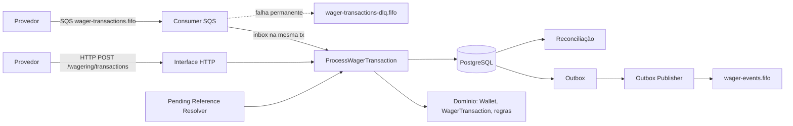

# Distributed Wagering Processor: prompt revisado e fluxo do sistema

Base: prompt original (0612e4aa) + enunciado do desafio Jungle Gaming (1c48641c).

---

## Decisões de projeto

Ordenados por severidade. Os itens 1 a 2 são falhas financeiras e precisam ser corrigidos antes de qualquer código.

| # | Severidade | Problema | Correção adotada |
|---|---|---|---|
| 1 | Crítica | O índice de reversão inclui `kind`. Um `REFUND` e um `ROLLBACK` podem reverter o mesmo `BET`, creditando duas vezes. Uma aposta de 25,00 gera +50,00. A regra 4 do desafio diz "pelo mesmo tipo", mas a invariante global diz "não duplicar créditos". | Índice único por `(provider_id, reference_external_transaction_id)` restrito a `kind IN ('REFUND','ROLLBACK')`. Documentar a decisão no `ARCHITECTURE.md`. |
| 2 | Crítica | O replay de `LOSS` e de `BET` zero não tem lançamento no ledger. Logo, o "saldo da época" não pode ser lido do ledger. | Gravar um snapshot `resulting_balance` em `wager_transactions`, no momento do processamento. |
| 3 | Alta | O prompt fala em `resulting_balance` na resposta. O contrato usa `balance`. | Contrato público: `balance`. O nome `resulting_balance` fica só na coluna interna. |
| 4 | Alta | O prompt mistura "permanente de negócio" (REJECTED + ACK) com "permanente de infraestrutura" (DLQ, status FAILED). | Tabela explícita de três classes de erro (seção 9). |
| 5 | Alta | Busca sem lock não enxerga uma transação concorrente ainda não commitada. Duas requisições iguais colidem no INSERT e caem no 23505. | Fast-path sem lock só para replay terminal (PROCESSED ou REJECTED), com comparação de chave e hash. O restante: trava a wallet e busca de novo sob o lock. O 23505 fica como rede de segurança. ADR-0005. |
| 6 | Alta | Se a rejeição de negócio for lançada como exceção, o rollback apaga o registro `REJECTED`. | Rejeição é resultado, não exceção. Persiste `REJECTED` no mesmo commit, sem tocar no saldo. |
| 7 | Média | Não está definido o que acontece quando a mesma `(provider, external)` chega com outra `Idempotency-Key`. | Conflito: `409 IDEMPOTENCY_KEY_CONFLICT`. |
| 8 | Média | Faltam as regras de referência: tipo permitido, valor igual, referência não `PROCESSED`, referência ausente. | Incluídas em RN-11 a RN-15 e na ordem de validação da seção 4.2. |
| 9 | Média | Faltam `PENDING_REFERENCE` com TTL e backoff, taxonomia HTTP, outbox completa, DLQ, `SIGTERM`, reconciliação, health e métricas. | Incluídos nas seções 5 a 12. |
| 10 | Média | A imutabilidade do ledger está só em código. | Trigger SQL bloqueando `UPDATE` e `DELETE`. |
| 11 | Baixa | As regras de escala do `Money` (2 casas, rejeitar em vez de arredondar, sem notação científica) não estão no prompt. | Incluídas na seção 3. |
| 12 | Decisão | O desafio não diz para qual fila vão os eventos do outbox. | Padrão adotado: `wager-events.fifo`, com `MessageGroupId = walletId`. |
| 13 | Decisão | Com vários publishers, a ordem dos eventos de uma mesma carteira pode se inverter. | Publisher com advisory lock por agregado publica só o pendente mais antigo e espera a confirmação antes do próximo. Eventos de wallet carregam `walletVersion`. ADR-0006. |
| 14 | Decisão | Não estava definido se `WIN` pode referenciar qualquer tipo e se precisa do mesmo valor. | `WIN` referencia só `BET` (RN-06), sem exigir valor igual, e não conta como reversão. `LOSS` aceita valor >= 0 sem efeito. |
| 15 | Decisão | Wallet criada com saldo inicial: a versão é 1 após o `OPENING` ou antes dele? | Versão 1 é o estado após o `OPENING`. A criação e o `OPENING` acontecem na mesma transação. |

---

## Requisitos e regras de implementação

Pronto para colar em uma sessão de código ou usar como especificação de revisão.

```
Atue como Principal Systems Architect, Red Team Lead e Staff Financial Systems Engineer.

PROJETO
Distributed Wagering Processor: serviço financeiro que processa transações de apostas
de múltiplos provedores de jogos (iGaming).

STACK OBRIGATÓRIA
- Bun 1.x (runtime, package manager e test runner)
- TypeScript em modo estrito
- NestJS
- MikroORM (preferencial; justificar no ARCHITECTURE.md)
- PostgreSQL
- AWS SQS FIFO via LocalStack ou MiniStack
- Docker Compose
- Migrations versionadas e reversíveis

OBJETIVO
Correção financeira absoluta com múltiplas instâncias, entrega at-least-once e falhas
de infraestrutura. Nunca: crédito ou débito duplicado, saldo negativo, lançamento
perdido, evento publicado antes do commit.

==========================================================================
1. PRINCÍPIOS NÃO NEGOCIÁVEIS
==========================================================================
1.1 Dinheiro nunca é number, float ou double. Money usa string decimal com escala
    fixa de 2 casas e aritmética exata (biblioteca decimal ou inteiros em centavos).
1.2 Money REJEITA (não arredonda) NaN, Infinity, notação científica, string vazia,
    mais de 2 casas decimais e valores negativos em contratos de entrada.
1.3 Idempotência é persistida no PostgreSQL. Cache em memória nunca é garantia.
1.4 O banco é a fonte da verdade. Unicidade, não-negatividade e imutabilidade vivem
    no schema (UNIQUE, CHECK, índice parcial, trigger), não só no código.
1.5 Concorrência por walletId, com lock de linha na wallet. Proibido lock global.
1.6 Nenhum saldo é calculado como read -> calculate -> write sem lock ou CAS.
1.7 Evento só é publicado depois do commit, gravado no outbox na mesma transação.
1.8 Ledger é append-only. Nenhuma linha é atualizada ou removida.
1.9 Testes de integração usam PostgreSQL e LocalStack/MiniStack reais em containers.
    Mocks só em testes unitários de lógica pura.

==========================================================================
2. CAMADAS E DEPENDÊNCIAS
==========================================================================
2.1 src/domain/
    TypeScript puro. Sem NestJS, sem MikroORM, sem SQS.
    Entidades com construtor privado e factories create / rehydrate.
    Contém: Money, Wallet, WagerTransaction, WalletLedgerEntry, InboxMessage,
    OutboxMessage, FailureCode e as regras de referência.
    rehydrate NÃO revalida transições. Só reconstrói estado já persistido.

2.2 src/application/
    Casos de uso: ProcessWagerTransaction, CreateWallet, GetWallet, GetLedger,
    GetTransaction, Reconcile, ResolvePendingReference, PublishOutbox.
    Define portas: WalletRepository, TransactionRepository, LedgerRepository,
    InboxRepository, OutboxRepository, UnitOfWork, Clock, EventPublisher.
    Não conhece HTTP nem SQS.

2.3 src/infrastructure/persistence/
    *OrmEntity.ts: entidades MikroORM, sem regra de negócio.
    mappers/: conversão bidirecional OrmEntity <-> domínio. Nenhum tipo ORM
    cruza essa fronteira.
    repositories/: implementam as portas da application.

2.4 src/infrastructure/messaging/
    Adapters SQS (publisher e consumer), serialização do envelope, DLQ.

2.5 src/interfaces/
    Controllers HTTP, DTOs com validação, mapeamento de erro de domínio para HTTP,
    entrypoint do consumer SQS.

2.6 Workers (Outbox Publisher, SQS Consumer, Pending Reference Resolver)
    Cada iteração ou mensagem começa com `const forkEm = this.em.fork()`.
    O Identity Map nunca cresce entre iterações.

==========================================================================
3. MODELO DE DOMÍNIO
==========================================================================
3.1 Money
    Imutável. amount: string decimal com 2 casas. currency: ISO-4217.
    add, subtract, negate, isZero, isPositive, isNegative, isLessThan, equals.
    Operações entre moedas diferentes lançam erro de domínio.
    Persistência: NUMERIC(19,2) + currency em colunas separadas, reidratado como Money.

3.2 Wallet (aggregate root)
    Campos: id, playerId, currency, balance, version, createdAt, updatedAt.
    Invariantes:
    - no máximo uma wallet por (playerId, currency);
    - saldo nunca negativo;
    - toda alteração de saldo tem um lançamento no ledger, e vice-versa;
    - moeda da operação == moeda da wallet;
    - version começa em 1 após a criação (inclui o OPENING) e incrementa somente
      quando o saldo muda.
    debit e credit retornam o resultado da operação (saldo antes, depois e lançamento).

3.3 WagerTransaction
    kind: OPENING (interno), BET, WIN, LOSS, REFUND, ROLLBACK.
    status: PENDING, PENDING_REFERENCE, PROCESSED, REJECTED, FAILED.
    Terminais: PROCESSED, REJECTED, FAILED.
    Transições válidas:
      PENDING           -> PROCESSED | REJECTED | PENDING_REFERENCE | FAILED
      PENDING_REFERENCE -> PROCESSED | REJECTED | FAILED
    Qualquer outra transição lança InvalidTransactionStateError.
    Guarda o snapshot resulting_balance (saldo observado ao processar). Obrigatório em PROCESSED (CHECK no schema, seção 12).
    Guarda failureCode quando REJECTED ou FAILED.

3.4 WalletLedgerEntry
    Imutável. No máximo uma entrada por (wallet, transaction).
    balanceBefore +/- money == balanceAfter, verificado na factory.
    Não existe para LOSS, para BET/WIN de valor zero, nem para REJECTED.

3.5 InboxMessage e OutboxMessage
    Conforme o enunciado (§6.5).

==========================================================================
4. REGRAS DE NEGÓCIO
==========================================================================
As regras estão em docs/REGRAS-DE-NEGOCIO.md (RN-01 a RN-41). Este documento não repete o texto. Cada item abaixo cita a regra que aplica.

4.1 Efeito por kind: OPENING (RN-04), BET (RN-05), WIN (RN-06), LOSS (RN-07), REFUND (RN-08), ROLLBACK (RN-09).

4.2 Ordem de validação de referência (REFUND, ROLLBACK e WIN com referência):
    a) referência ausente: PENDING_REFERENCE (RN-12);
    b) existe e não está PROCESSED: REFERENCE_NOT_PROCESSED (RN-13);
    c) contexto diferente: REFERENCE_CONTEXT_MISMATCH (RN-14);
    d) tipo não permitido: REFERENCE_KIND_NOT_ALLOWED (RN-06, RN-08, RN-09);
    e) valor diferente: REFERENCE_AMOUNT_MISMATCH (RN-15);
    f) já revertida: REFERENCE_ALREADY_REVERSED (RN-16);
    g) reversão que deixa saldo negativo: REVERSAL_WOULD_CAUSE_NEGATIVE_BALANCE (RN-17).

4.3 Demais rejeições: CURRENCY_MISMATCH (RN-01), WALLET_PLAYER_MISMATCH (RN-38), INSUFFICIENT_FUNDS (RN-05).

4.4 Replay, conflito e formato de hash: RN-20 a RN-24. Estados: RN-25. FAILED: RN-41.

==========================================================================
5. FLUXO ATÔMICO DE UMA TRANSAÇÃO
==========================================================================
HTTP e SQS executam o MESMO caso de uso. Não há caminho paralelo.

5.1 Validar o payload (DTO ou schema).
    HTTP: 400 INVALID_PAYLOAD. SQS: mensagem malformada vai para a DLQ (RN-34).

5.2 Calcular payloadHash.
    JSON canônico (chaves ordenadas, recursivo) dos campos de negócio:
    providerId, externalTransactionId, playerId, walletId, roundId, gameId,
    kind, money{amount,currency}, referenceExternalTransactionId (quando houver).
    Excluídos: header Idempotency-Key e metadados de transporte.
    Algoritmo: SHA-256 em hex. Documentar no ARCHITECTURE.md.

5.3 Abrir transação SQL.
    SET LOCAL lock_timeout = '3000ms';
    SET LOCAL statement_timeout = '5000ms';

5.4 Fast-path sem lock (ADR-0005).
    Busca por idempotency_key OU (provider_id, external_transaction_id), sem FOR UPDATE.
    - Encontrada em PROCESSED ou REJECTED, mesma chave e mesmo hash: replay (RN-20). Não abre transação de escrita.
    - Encontrada em PROCESSED ou REJECTED com hash diferente: 409 IDEMPOTENCY_PAYLOAD_MISMATCH (RN-21).
    - Encontrada com chave diferente para o mesmo par: 409 IDEMPOTENCY_KEY_CONFLICT (RN-22).
    - Qualquer outro caso (não encontrada, ou PENDING_REFERENCE): segue para 5.5.

5.5 Slow-path: trava a wallet e repete a busca sob o lock.
    SELECT ... FROM wallets WHERE id = $1 FOR UPDATE;
    O lock de linha da wallet é mantido até o COMMIT ou ROLLBACK da transação.
    Não existe: 404 WALLET_NOT_FOUND na API, sem gravar nada. Na fila: sem ack e sem gravar (RN-39).
    Depois do lock, a busca idempotente é repetida:
    - Encontrado, mesma chave, mesmo hash, mesma (provider, external): replay (RN-20). Não modifica nada.
    - Encontrado com hash diferente: 409 IDEMPOTENCY_PAYLOAD_MISMATCH.
    - Encontrado com chave diferente para a mesma (provider, external): 409 IDEMPOTENCY_KEY_CONFLICT.
    - Encontrado em PENDING_REFERENCE: 202, com idempotentReplay: true.

5.6 Decisão de domínio.
    Aplica (debit/credit), rejeita com failureCode, ou marca PENDING_REFERENCE.

5.7 Persistir na MESMA transação SQL:
    a) wager_transactions (com resulting_balance e status);
    b) wallets: UPDATE ... WHERE id = $1 AND version = $v (CAS de segurança);
    c) wallet_ledger_entries, somente se o saldo mudou;
    d) inbox_messages, somente se a entrada veio da fila;
    e) outbox_messages, um por evento devido.

5.8 COMMIT. Só depois: resposta HTTP ou ack SQS.

5.9 Tratamento de erros
    - Rejeição de negócio NÃO é exceção. É resultado persistido com commit normal.
    - 23505 (unique_violation): ROLLBACK; forkEm = em.fork(); buscar a linha
      já commitada; comparar hash; retornar replay ou 409. Nunca 500.
    - 55P03 (lock_not_available), 40P01 (deadlock), 40001 (serialization_failure),
      timeout de conexão: transitório. HTTP 503 com Retry-After. SQS: throw.
    - Erro desconhecido: transitório por padrão. Nunca confirmar sucesso.

==========================================================================
6. REVERSÕES E TRAVA FÍSICA
==========================================================================
6.1 Validação em memória (seção 4.2) antes de qualquer escrita.
6.2 Trava física no banco:

    CREATE UNIQUE INDEX uq_wager_single_processed_reversal
      ON wager_transactions (provider_id, reference_external_transaction_id)
      WHERE status = 'PROCESSED'
        AND kind IN ('REFUND', 'ROLLBACK')
        AND reference_external_transaction_id IS NOT NULL;

    A cláusula kind IN (...) impede que um WIN com referência ocupe o slot de
    reversão. A chave sem kind impede REFUND + ROLLBACK no mesmo BET.

6.3 Se a transição para PROCESSED disparar esta trava (23505), a transação vira
    REJECTED com REFERENCE_ALREADY_REVERSED (RN-16), em transação nova, pelo caso
    de uso da seção 5, sob lock da wallet, sem retry. WagerTransactionRejected é
    publicado (RN-27).

==========================================================================
7. TRANSAÇÕES DE VALOR ZERO (free spins)
==========================================================================
Regra: RN-10. Implementação: Money.isZero() é válido; Wallet não altera saldo nem versão; nenhuma linha em wallet_ledger_entries; wager_transactions grava resulting_balance; o outbox recebe WagerTransactionProcessed e não WalletBalanceChanged (RN-28).

==========================================================================

8. REFERÊNCIAS FORA DE ORDEM
==========================================================================
8.1 Ao marcar PENDING_REFERENCE:
    - gravar next_reference_attempt_at e attempts = 0;
    - publicar WagerTransactionPendingReference.
8.2 Worker ResolvePendingReference (forkEm por item):
    SELECT ... FROM wager_transactions
    WHERE status = 'PENDING_REFERENCE' AND next_reference_attempt_at <= now()
    ORDER BY next_reference_attempt_at
    LIMIT 50 FOR UPDATE SKIP LOCKED;
    Para cada item, executa o MESMO caso de uso da seção 5, sob lock da wallet.
8.3 Backoff exponencial: base 2 s, fator 2, teto 5 min, jitter de +/- 20%.
8.4 Limite: 12 tentativas OU TTL de 24 h contadas a partir de created_at, o que vier primeiro (RN-12). Justificar no
    ARCHITECTURE.md.
8.5 Esgotado: REJECTED com REFERENCE_NOT_FOUND, e WagerTransactionRejected publicado.
    A transição para REJECTED com REFERENCE_NOT_FOUND é feita pelo caso de uso da seção 5, sob lock da wallet, como o resolvedor da seção 8.2.

==========================================================================
9. ERROS, FAILURE CODES E HTTP
==========================================================================
9.1 Três classes de erro (tratamento por classe, sem exceção):

    | Classe | Exemplo | Efeito |
    |---|---|---|
    | Negócio permanente | INSUFFICIENT_FUNDS, CURRENCY_MISMATCH, WALLET_PLAYER_MISMATCH, REFERENCE_* | Persistir REJECTED, commit, ack. Sem retry, sem DLQ. |
    | Malformada / inválida | payload sem schema, JSON inválido, kind OPENING, type diferente (RN-34) | Não processar. Enviar para a DLQ e fazer ack da original. |
    | Transitória de infra | timeout de banco, deadlock, lock_timeout, SQS indisponível, wallet inexistente na fila (RN-39) | Não fazer ack. Lançar erro. O SQS reentrega com backoff. |
    | Permanente de infra | esgotou maxReceiveCount | Vai para a DLQ. FAILED só é gravado pelo resolvedor de pendências (RN-41). |

9.2 Mapeamento HTTP

    | Situação | HTTP | Corpo |
    |---|---|---|
    | Transação nova PROCESSED | 201 | status, balance, idempotentReplay: false |
    | Replay de PROCESSED | 200 | mesmo corpo original, idempotentReplay: true |
    | PENDING_REFERENCE (nova ou replay) | 202 | status PENDING_REFERENCE, idempotentReplay conforme o caso |
    | Rejeição de negócio (nova ou replay) | 422 | status REJECTED, failureCode |
    | Payload inválido, incluindo kind OPENING (RN-04) | 400 | INVALID_PAYLOAD, detalhes de validação |
    | Idempotency-Key ausente | 400 | MISSING_IDEMPOTENCY_KEY |
    | Conflito de payload ou chave | 409 | IDEMPOTENCY_PAYLOAD_MISMATCH / IDEMPOTENCY_KEY_CONFLICT |
    | Wallet duplicada | 409 | WALLET_ALREADY_EXISTS |
    | Não encontrado | 404 | WALLET_NOT_FOUND, TRANSACTION_NOT_FOUND |
    | Transitório | 503 | TRANSIENT_FAILURE, com Retry-After |

    Regra: colapsar situações distintas em um mesmo código é proibido.
    failureCode só existe em transação REJECTED persistida. 400, 404, 409 e 503 não têm failureCode (RN-40).

9.3 failureCode (somente em transação REJECTED persistida, RN-19 e RN-40):
    INSUFFICIENT_FUNDS, CURRENCY_MISMATCH, WALLET_PLAYER_MISMATCH,
    REFERENCE_NOT_FOUND, REFERENCE_NOT_PROCESSED, REFERENCE_CONTEXT_MISMATCH,
    REFERENCE_KIND_NOT_ALLOWED, REFERENCE_AMOUNT_MISMATCH,
    REFERENCE_ALREADY_REVERSED, REVERSAL_WOULD_CAUSE_NEGATIVE_BALANCE.
    Lista ampliável. Cada código novo entra em docs/REGRAS-DE-NEGOCIO.md antes do código.

==========================================================================

10. MENSAGERIA SQS FIFO
==========================================================================
10.1 Filas
    wager-transactions.fifo        (entrada)
    wager-transactions-dlq.fifo    (redrive com maxReceiveCount = 5)
    wager-events.fifo              (saída do outbox)
    Todas as mensagens: MessageGroupId = walletId.
    MessageDeduplicationId = messageId ou eventId.

Mensagem de entrada (enunciado §10): `type` = `WagerTransactionRequested`, `messageId`, `occurredAt` e `data` com providerId, externalTransactionId, idempotencyKey, playerId, walletId, roundId, gameId, kind e money. `type` diferente ou campo ausente é malformada (RN-34).

10.2 Consumer
    Long polling. Batch de 1 a 10. Concorrência limitada por processo.
    Para cada mensagem:
    1. Validar o schema (seção 9.1, classe malformada).
    2. Leitura rápida do inbox por (consumer_name, message_id). Se a mensagem já foi processada: ack e pular (RN-20).
    3. Executar o caso de uso da seção 5. O INSERT no inbox fica na mesma transação SQL do efeito. Se a leitura rápida não viu a mensagem e o INSERT colidir (23505), vale a seção 5.9.
    4. COMMIT, depois ack.

10.3 Retry
    Transitório: não fazer ack. Ajustar a visibilidade com
    ChangeMessageVisibility, usando backoff exponencial calculado a partir de
    ApproximateReceiveCount.

10.4 SIGTERM
    Parar o polling. Aguardar mensagens em andamento por até 25 s. Qualquer
    mensagem não concluída recebe ChangeMessageVisibility(0).

10.5 Redelivery não pode duplicar efeito. A inbox e a trava de reversão garantem isso.

==========================================================================
11. TRANSACTIONAL OUTBOX
==========================================================================
11.1 Eventos mínimos
    WagerTransactionProcessed        toda transação aplicada, inclusive LOSS e zero
    WagerTransactionRejected         rejeição de negócio, inclusive REFERENCE_NOT_FOUND
    WalletBalanceChanged             SOMENTE quando o saldo muda
    WagerTransactionPendingReference referência ausente

11.2 Envelope: classe abstrata IntegrationEvent<T>, uma subclasse por evento.
    eventType e version no tipo, nunca em string solta.
    toJSON(): eventId, eventType, aggregateId, correlationId, causationId?,
    occurredAt (ISO-8601), version, data.
    data usa MoneyProps (string decimal), nunca a instância Money.
    Eventos de wallet incluem walletVersion para ordenação no consumidor.

11.3 Publisher por agregado (N instâncias concorrentes). Justificativa e teste de ordem: ADR-0006.
    Agregado: aggregate_id é o walletId da carteira afetada pelo evento, em
    todos os eventos da seção 11.1. Assim, o agregado travado pelo publisher é
    o mesmo MessageGroupId da seção 10.1, e a ordem fica garantida por carteira
    (decisão 13). O evento só existe no outbox depois do commit do efeito
    (RN-30).
    Ordem dos eventos: a coluna seq (bigserial, seção 12) define a ordem, sem
    desempate por occurred_at ou id. A ordem dentro da carteira vem do lock de
    linha da wallet (RN-31, seção 5.5): como o lock dura até o COMMIT, as
    transações de uma mesma carteira são serializadas, e o seq cresce na ordem
    de commit dentro da carteira.
    Passo 1, fora de transação: candidatos são os agregados cujo pendente mais
    antigo já venceu.
      SELECT aggregate_id
      FROM (
        SELECT DISTINCT ON (aggregate_id) aggregate_id, seq, next_attempt_at
        FROM outbox_messages
        WHERE published_at IS NULL
        ORDER BY aggregate_id, seq
      ) AS head
      WHERE head.next_attempt_at <= now()
      ORDER BY head.seq
      LIMIT 100;
      O filtro de next_attempt_at vale só para o pendente mais antigo de cada
      agregado, depois de escolhido. Filtrar antes de escolher publicaria um
      evento posterior antes de um anterior em backoff. Um agregado com o mais
      antigo em backoff fica fora do lote e não ocupa vaga no LIMIT.
    Passo 2, por agregado ($1 = aggregate_id; $2 = id lido no passo b), numa
    transação que continua aberta durante a chamada ao SQS (passo c): o advisory
    lock e o FOR UPDATE só são liberados no COMMIT do passo d ou e.
      a) SELECT pg_try_advisory_xact_lock(hashtext($1::text));
         Falso: outro publisher tem o agregado; pular. O cast ::text é
         obrigatório, porque hashtext(uuid) não existe. hashtext devolve int4:
         duas carteiras podem colidir, e o efeito é só pular um agregado
         neste ciclo, sem risco para a ordem.
      b) SELECT id, seq, aggregate_id, event_type, payload, occurred_at, attempts, next_attempt_at
         FROM outbox_messages
         WHERE aggregate_id = $1 AND published_at IS NULL
         ORDER BY seq
         LIMIT 1
         FOR UPDATE;
         Sem filtro de next_attempt_at. Se next_attempt_at > now(), porque o
         estado mudou desde o passo 1, pular o agregado inteiro: nenhum evento
         posterior do mesmo agregado sai antes dele.
      c) SendMessage em wager-events.fifo com MessageGroupId = walletId
         (o aggregate_id) e MessageDeduplicationId = eventId.
      d) Ack do SQS (resposta de sucesso do SendMessage):
           UPDATE outbox_messages SET published_at = now()
           WHERE id = $2 AND published_at IS NULL;
         depois COMMIT, que libera o lock. published_at nunca é gravado antes
         do ack.
      e) Falha ou timeout no envio, sem ack:
           UPDATE outbox_messages
           SET attempts = attempts + 1, next_attempt_at = now() + $3
           WHERE id = $2 AND published_at IS NULL;
         ($3 = intervalo de backoff), depois COMMIT. O próximo ciclo tenta de novo.
    Duplicata: falha entre o ack e o COMMIT republica o evento. O SQS FIFO
    descarta a repetição com o mesmo MessageDeduplicationId dentro da janela de
    deduplicação de 5 minutos; depois dela, o consumidor deduplica por eventId
    e, nos eventos de wallet, compara walletVersion (seção 11.2).
    Ordem: o próximo evento do agregado só é publicado depois do COMMIT do anterior. O teste de ordem é exigido pela Fase 8 (Concorrência) da Parte 3, com dois publishers.

11.4 Métrica outbox lag = agora - occurred_at do pendente mais antigo.

11.5 Cenário de recuperação obrigatório
    1. commit confirmado; 2. processo morre antes de publicar; 3. outra instância
    assume; 4. evento publicado; 5. publicação duplicada não causa dano.

==========================================================================
12. SCHEMA MÍNIMO (constraints obrigatórias)
==========================================================================
    CREATE TABLE wallets (
      id uuid PRIMARY KEY,
      player_id uuid NOT NULL,
      currency char(3) NOT NULL,
      balance_amount numeric(19,2) NOT NULL CHECK (balance_amount >= 0),
      version integer NOT NULL CHECK (version >= 1),
      created_at timestamptz NOT NULL,
      updated_at timestamptz NOT NULL,
      UNIQUE (player_id, currency)
    );

    CREATE TABLE wager_transactions (
      id uuid PRIMARY KEY,
      provider_id text NOT NULL,
      external_transaction_id text NOT NULL,
      idempotency_key text NOT NULL UNIQUE,
      payload_hash char(64) NOT NULL,
      wallet_id uuid NOT NULL REFERENCES wallets(id),
      player_id uuid NOT NULL,
      round_id text NOT NULL,
      game_id text NOT NULL,
      kind text NOT NULL CHECK (kind IN ('OPENING','BET','WIN','LOSS','REFUND','ROLLBACK')),
      amount numeric(19,2) NOT NULL CHECK (amount >= 0),
      currency char(3) NOT NULL,
      reference_external_transaction_id text,
      reference_transaction_id uuid REFERENCES wager_transactions(id),
      status text NOT NULL CHECK (status IN ('PENDING','PENDING_REFERENCE','PROCESSED','REJECTED','FAILED')),
      failure_code text,
      resulting_balance numeric(19,2) CHECK (resulting_balance >= 0),
      attempts integer NOT NULL DEFAULT 0,
      next_reference_attempt_at timestamptz,
      created_at timestamptz NOT NULL,
      processed_at timestamptz,
      UNIQUE (provider_id, external_transaction_id),
      CHECK (kind NOT IN ('REFUND','ROLLBACK') OR reference_external_transaction_id IS NOT NULL),
      CHECK (status <> 'PROCESSED' OR resulting_balance IS NOT NULL)
    );

    CREATE UNIQUE INDEX uq_wager_single_processed_reversal
      ON wager_transactions (provider_id, reference_external_transaction_id)
      WHERE status = 'PROCESSED' AND kind IN ('REFUND','ROLLBACK')
        AND reference_external_transaction_id IS NOT NULL;

    CREATE INDEX ix_wager_pending_reference
      ON wager_transactions (next_reference_attempt_at)
      WHERE status = 'PENDING_REFERENCE';

    CREATE TABLE wallet_ledger_entries (
      id uuid PRIMARY KEY,
      wallet_id uuid NOT NULL REFERENCES wallets(id),
      transaction_id uuid NOT NULL REFERENCES wager_transactions(id),
      direction text NOT NULL CHECK (direction IN ('DEBIT','CREDIT')),
      amount numeric(19,2) NOT NULL CHECK (amount > 0),
      balance_before numeric(19,2) NOT NULL CHECK (balance_before >= 0),
      balance_after numeric(19,2) NOT NULL CHECK (balance_after >= 0),
      created_at timestamptz NOT NULL,
      UNIQUE (transaction_id, wallet_id),
      CHECK (
        (direction = 'CREDIT' AND balance_after = balance_before + amount) OR
        (direction = 'DEBIT'  AND balance_after = balance_before - amount)
      )
    );

    CREATE FUNCTION forbid_ledger_mutation() RETURNS trigger AS $$
    BEGIN
      RAISE EXCEPTION 'wallet_ledger_entries é append-only';
    END;
    $$ LANGUAGE plpgsql;

    CREATE TRIGGER trg_ledger_append_only
      BEFORE UPDATE OR DELETE ON wallet_ledger_entries
      FOR EACH ROW EXECUTE FUNCTION forbid_ledger_mutation();

    CREATE INDEX ix_ledger_wallet_cursor
      ON wallet_ledger_entries (wallet_id, created_at DESC, id DESC);

    CREATE TABLE inbox_messages (
      consumer_name text NOT NULL,
      message_id text NOT NULL,
      payload_hash char(64) NOT NULL,
      received_at timestamptz NOT NULL,
      processed_at timestamptz,
      PRIMARY KEY (consumer_name, message_id)
    );

    CREATE TABLE outbox_messages (
      id uuid PRIMARY KEY,
      seq bigserial NOT NULL,
      aggregate_id uuid NOT NULL,
      event_type text NOT NULL,
      payload jsonb NOT NULL,
      occurred_at timestamptz NOT NULL,
      attempts integer NOT NULL DEFAULT 0,
      next_attempt_at timestamptz NOT NULL,
      published_at timestamptz
    );

    CREATE INDEX ix_outbox_pending
      ON outbox_messages (aggregate_id, seq)
      WHERE published_at IS NULL;

    CREATE FUNCTION forbid_terminal_status_change() RETURNS trigger AS $$
    BEGIN
      IF OLD.status IN ('PROCESSED','REJECTED','FAILED') AND NEW.status <> OLD.status THEN
        RAISE EXCEPTION 'transação em estado terminal não muda de status';
      END IF;
      RETURN NEW;
    END;
    $$ LANGUAGE plpgsql;

    CREATE TRIGGER trg_wager_terminal_status
      BEFORE UPDATE OF status ON wager_transactions
      FOR EACH ROW EXECUTE FUNCTION forbid_terminal_status_change();

==========================================================================
13. CONTRATOS HTTP
==========================================================================
    POST /wallets                       { playerId, initialBalance{amount,currency} }
      Cria wallet e OPENING (se > 0) na mesma transação. Versão 1 após o OPENING.
    GET  /wallets/:walletId
    GET  /wallets/:walletId/ledger?cursor=...&limit=50   cursor opaco e estável
    GET  /wagering/transactions/:transactionId
    GET  /providers/:providerId/wagering/transactions/:externalTransactionId
    POST /wagering/transactions         header Idempotency-Key obrigatório
      Default da chave: "{providerId}:{externalTransactionId}"
    POST /wallets/:walletId/reconciliation
      Sem corpo na requisição (RN-37). Soma o ledger de forma independente (não usa balance_after).
      Resposta: { walletId, storedBalance, calculatedBalance, difference, consistent, checkedEntries }.
      Divergência: loga, incrementa métrica e responde consistent: false. NÃO corrige.
    GET  /health/live                   processo vivo (sem autenticação)
    GET  /health/ready                  PostgreSQL e SQS alcançáveis (sem autenticação)

    Autenticação: decisão do candidato. Se não implementar, documentar no
    ARCHITECTURE.md e expor um ponto de extensão (AuthGuard no-op ou
    ProviderIdentityPort). Identidade do provedor na mensagem continua sujeita
    às validações de domínio.

==========================================================================
14. OBSERVABILIDADE
==========================================================================
14.1 Logs estruturados JSON com correlationId, messageId, transactionId,
     walletId, providerId. NUNCA payload financeiro completo nem dado sensível.
14.2 Métricas mínimas: transações por status; duplicatas detectadas; retries;
     mensagens em DLQ; conflitos de lock; outbox lag; latência de processamento.
14.3 Health separado para liveness e readiness.

==========================================================================
15. TESTES
==========================================================================
15.1 Unidade: Money (escala, arredondamento, entradas inválidas); invariantes
     da Wallet; regras de cada kind; conflito de moeda; chave com payload
     divergente; validação de 5 vias; reversão única; zero.
15.2 Integração (containers reais): migrations e constraints (incluindo que o
     índice de reversão bloqueia REFUND + ROLLBACK no mesmo BET); trigger de
     ledger; atomicidade wallet/ledger/inbox/outbox; inbox e redelivery;
     publishers concorrentes; retry e DLQ; recuperação após reinício.
15.3 Concorrência (paralelismo real):
     a) mesma aposta 50 vezes em paralelo -> um débito;
     b) cenário obrigatório: saldo 100,00; duas apostas de 80,00 simultâneas ->
        uma PROCESSED, uma REJECTED, saldo final 20,00, um único débito;
     c) wallets distintas em paralelo;
     d) >= 3 instâncias simultâneas;
     e) worker morto depois do commit e antes do ack;
     f) dois publishers sobre o mesmo outbox;
     g) ROLLBACK ou REFUND antes da referência;
     h) reinício com comprovação de consistência final.
15.4 Invariante final de todo teste:
     wallet.balance == saldo reconstruído pelo ledger.

==========================================================================
16. ENTREGÁVEIS E CRITÉRIOS DE ACEITE
==========================================================================
16.1 README.md: setup, docker compose up, migrations up/down, comandos
     (bun run test, bun run test:integration, bun run test:concurrency,
     bun run test:load opcional).
16.2 ARCHITECTURE.md: escolha de ORM e de Money; estratégia de lock;
     idempotência; outbox; reversão única (RN-16); PENDING_REFERENCE e TTL;
     taxonomia de erros; decisão de autenticação; trade-offs; limitações.
16.3 Falhas eliminatórias: number para dinheiro; saldo negativo por race;
     débito ou crédito duplicado; idempotência só em memória; solução correta
     só com uma instância; evento antes do commit; ledger ausente; testes
     só com mocks de PostgreSQL ou SQS.

==========================================================================
17. REGRAS DE TRABALHO PARA A SESSÃO
==========================================================================
- Antes de codar, registrar no ARCHITECTURE.md cada decisão em aberto e a
  escolha feita. Não deixar decisão implícita.
- Ordem: domínio puro com testes unitários -> schema e migrations -> repositórios
  -> caso de uso -> HTTP -> outbox -> SQS consumer -> pending reference worker
  -> testes de concorrência -> observabilidade -> documentação.
- Não pular para infraestrutura antes de o domínio estar coberto por testes.
- Ao final, entregar: código, testes, docs e lista das decisões tomadas.
```

---

## Parte 2. Fluxo do sistema em altíssimo nível

### 2.1 Visão de componentes



### 2.2 Camadas

| Camada | Responsabilidade | Não faz |
|---|---|---|
| Infra local | Docker Compose: PostgreSQL, LocalStack ou MiniStack (cria as filas FIFO), N réplicas da app | Não contém regra de negócio |
| Interface | Controllers, DTOs, mapeamento de erro para HTTP, entrypoint do consumer | Não decide saldo nem regra financeira |
| Application | Orquestra o caso de uso dentro de uma transação, define portas | Não conhece HTTP, SQS nem ORM |
| Domain | Money, Wallet, WagerTransaction, regras de referência, failure codes | Não conhece banco, framework nem fila |
| Persistence | Repositórios, mappers, constraints, locks | Não decide regra de negócio |
| Messaging | Inbox, outbox, publisher, consumer, DLQ | Não publica antes do commit |
| Workers | Outbox publisher, pending reference resolver, consumer loop | Não usa EntityManager global |
| Observabilidade | Logs JSON, métricas, health | Não loga payload financeiro completo |

### 2.3 Fluxo A: aposta via HTTP

1. Provedor envia `POST /wagering/transactions` com `Idempotency-Key`.
2. Interface valida o DTO. Inválido: 400.
3. Caso de uso calcula o payloadHash.
4. Abre transação SQL com timeouts.
5. Trava a linha da wallet (`FOR UPDATE`).
6. Busca idempotente. Se já existir: replay, conflito ou pendência. Fim.
7. Domínio aplica o débito, ou rejeita com `INSUFFICIENT_FUNDS`.
8. Persiste transação, saldo, ledger e outbox na mesma transação.
9. COMMIT.
10. Responde 201 (nova) ou 422 (rejeitada). Se houve 23505 ou erro transitório, aplica a seção 5.9.

### 2.4 Fluxo B: mensagem da fila com redelivery

1. Consumer recebe a mensagem. Schema inválido: DLQ e ack.
2. Leitura rápida do inbox. Se a mensagem já foi processada, ack e pular.
3. Executa o mesmo caso de uso do fluxo A. O INSERT no inbox fica na mesma transação.
4. COMMIT, depois ack.
5. Se houver falha transitória antes do commit, nada é gravado. A mensagem volta com backoff.
6. Se o processo morrer depois do commit e antes do ack, a reentrega cai no inbox e é ignorada.

### 2.5 Fluxo C: reversão fora de ordem

1. `ROLLBACK` de um `BET` chega antes da `BET`.
2. Referência ausente: transação vira `PENDING_REFERENCE` e o evento correspondente é publicado.
3. Resposta 202.
4. Worker ResolvePendingReference reprocessa com backoff, usando o caso de uso da seção 5.
5. Quando a BET é processada, o ROLLBACK é aplicado.
6. Se a BET nunca chegar: após 12 tentativas ou 24 h, REJECTED com `REFERENCE_NOT_FOUND`.

### 2.6 Fluxo D: recuperação do outbox após falha

1. Commit confirmado. Processo morre antes de publicar.
2. Outras instâncias do publisher tentam o advisory lock do agregado. Se estiver livre e o evento mais antigo já estiver vencido, publicam esse evento.
3. O evento é publicado. A marcação `published_at` pode falhar: a publicação é repetida.
4. Consumidores ignoram duplicatas pelo `eventId` e comparam `walletVersion`.

### 2.7 Fluxo E: shutdown (SIGTERM)

1. Para de consumir novas mensagens.
2. Aguarda até 25 s pelas mensagens em andamento.
3. Mensagens não concluídas recebem visibilidade zero.
4. Outbox publisher termina o lote atual e encerra.
5. Health passa a `not ready`.

### 2.8 Reconciliação

1. Lê todos os lançamentos da wallet.
2. Calcula a soma de créditos menos débitos, independentemente do `balance_after`.
3. Compara com o saldo armazenado.
4. Divergência: loga, incrementa a métrica e retorna `consistent: false`. Não corrige.

---

## Parte 3. Plano de fases

| Fase | Entregável | Critério de saída |
|---|---|---|
| 0. Base | Repositório, Bun, NestJS, Docker Compose com PostgreSQL e LocalStack ou MiniStack, filas FIFO criadas | `docker compose up` sobe tudo e a readiness responde |
| 1. Domínio | Money, Wallet, WagerTransaction, LedgerEntry, regras de referência, failure codes | Testes unitários cobrindo as regras da seção 15.1 |
| 2. Schema | Migrations com constraints, índice de reversão, trigger de ledger | Teste de integração provando que REFUND + ROLLBACK no mesmo BET falha |
| 3. Persistência | OrmEntities, mappers, repositórios, UnitOfWork | Round-trip domínio -> banco -> domínio sem perda |
| 4. Caso de uso | ProcessWagerTransaction com lock, replay, 23505 e rejeição como resultado | Cenário 80 + 80 passa com um débito |
| 5. HTTP | Controllers, taxonomia de status, endpoints de consulta e wallet | Contratos da seção 13 testados |
| 6. Mensageria | Inbox, outbox, publisher, consumer, DLQ, SIGTERM | Crash entre commit e ack não duplica efeito |
| 7. Pending reference | Worker com backoff, TTL e limite | Caso ROLLBACK antes de BET resolve e caso sem BET expira |
| 8. Concorrência | Testes de 50 paralelos, 3 instâncias, dois publishers | Invariante final verde em todos |
| 9. Observabilidade | Logs, métricas, health | Métricas da seção 14 expostas |
| 10. Documentação | README, ARCHITECTURE.md, decisões de projeto e ADRs | Revisão de um colega consegue subir o projeto só com o README |
| 11. Opcional | Teste de carga com `bun run test:load` | Ambiente, metodologia, p50/p95/p99, erro e outbox lag registrados |

---
