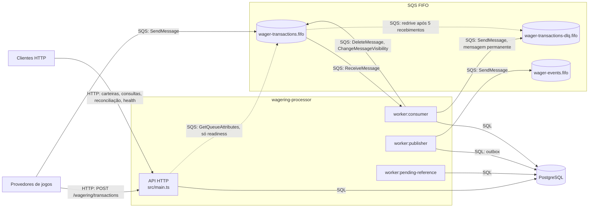

# Componentes

Processos do serviço, as filas SQS e o PostgreSQL, com o tipo de comunicação em cada seta. As filas estão definidas em `src/infrastructure/messaging/queues.ts`.

## Onde cada seta está no código

- **Provedor para a API:** `src/interfaces/http/wagering.controller.ts:41`.
- **Clientes para a API:**
  - `src/interfaces/http/wallets.controller.ts:47` a `:81`;
  - `src/interfaces/http/wagering.controller.ts:81` e `:86`;
  - `src/interfaces/http/health.controller.ts:18` e `:25`.
- **API para o SQS:** só na readiness, com `GetQueueAttributes` na fila de entrada (`src/infrastructure/messaging/sqs-readiness-check.ts:17`).
- **Consumer:** `src/infrastructure/messaging/sqs-wager-consumer.ts`.
  - `ReceiveMessage` na linha 97;
  - `SendMessage` para a DLQ na linha 234;
  - `DeleteMessage` na linha 249;
  - `ChangeMessageVisibility` na linha 259.
- **Redrive:** `maxReceiveCount` 5, em `src/infrastructure/messaging/queues.ts` e `scripts/localstack/create-queues.sh`.
- **Publisher:**
  - SQL do outbox em `src/infrastructure/persistence/postgres-outbox-publication-store.ts:28` a `:72`;
  - `SendMessage` em `src/infrastructure/messaging/outbox-publisher.ts:99`.
- **Resolvedor de pendências:** só SQL. Usa `src/application/use-cases/resolve-pending-reference.ts` e o repositório de transações.

## Divergências em relação ao pedido

- **A API também fala com o SQS.** Faz só a chamada da readiness, sem enviar nem receber mensagens. A seta é tracejada.
- **A DLQ recebe por dois caminhos:** o `SendMessage` explícito do consumer, para mensagem malformada ou permanente, e o redrive automático do SQS depois de 5 recebimentos sem ack.
- **O `worker:pending-reference` não fala com o SQS.** Os eventos que ele gera vão para o outbox no PostgreSQL e saem pelo `worker:publisher`.
- **O código não distingue provedor de cliente HTTP.** O `AuthGuard` aceita toda requisição (ADR-0008). A separação do diagrama mostra o uso, não uma regra do código. Um provedor pode usar a API ou a fila de entrada.
