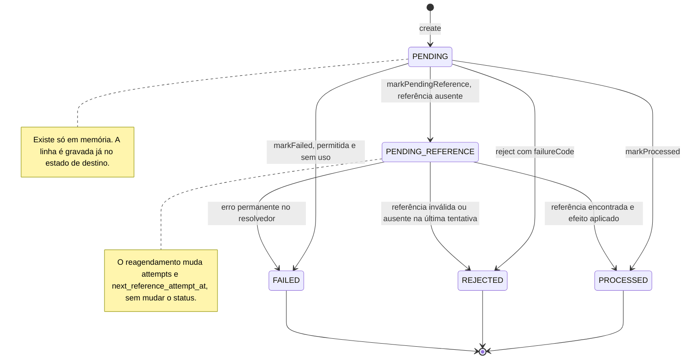

# Estados de WagerTransaction

As transições são as do mapa `TRANSITIONS` em `src/domain/wager-transaction.ts:18` a `:24` (RN-25). Os estados terminais são `PROCESSED`, `REJECTED` e `FAILED`, conforme o conjunto `TERMINAL` na linha 15. Qualquer transição fora do mapa lança `InvalidTransactionStateError`.

## Onde cada transição acontece

| Transição | Método no domínio | Quem chama |
|---|---|---|
| `PENDING` para `PROCESSED` | `markProcessed` (`wager-transaction.ts:160`) | `apply-wager-rules.ts:93` |
| `PENDING` para `REJECTED` | `reject` (`wager-transaction.ts:176`) | `apply-wager-rules.ts:117`, via `rejectWager` |
| `PENDING` para `PENDING_REFERENCE` | `markPendingReference` (`wager-transaction.ts:188`) | `process-wager-transaction.ts:201` |
| `PENDING` para `FAILED` | `markFailed` (`wager-transaction.ts:206`) | nenhum caminho de produção |
| `PENDING_REFERENCE` para `PROCESSED` | `markProcessed` | `resolve-pending-reference.ts:111`, pelo `applyWagerRules` |
| `PENDING_REFERENCE` para `REJECTED` | `reject` | `resolve-pending-reference.ts:107` (23505 de reversão), `:111` (referência inválida) e `:118` (`REFERENCE_NOT_FOUND`) |
| `PENDING_REFERENCE` para `FAILED` | `UPDATE` condicional no repositório, sem o método do domínio | `resolve-pending-reference.ts:144`, que chama `markPendingReferenceFailed` em `mikro-orm-transaction.repository.ts:105` |

Os caminhos citados estão em `src/domain/`, `src/application/use-cases/` e `src/infrastructure/persistence/repositories/`.

## Divergências em relação ao pedido

- **`PENDING` nunca é gravado.** O estado existe na entidade, mas a transação nasce em memória e é gravada já em `PROCESSED`, `REJECTED` ou `PENDING_REFERENCE` (SPEC 3.3).
- **`PENDING` para `FAILED` não tem caminho de produção.** O domínio permite a transição (RN-25), mas nenhum caso de uso a usa: o HTTP responde 503 e a fila não faz ack (SPEC 3.3).
- **`PENDING_REFERENCE` para `FAILED` não passa pelo método `markFailed`.** Passa por um `UPDATE` com `WHERE status = 'PENDING_REFERENCE'`, porque a linha que causa o erro permanente pode ser justamente a que o domínio não reidrata (ADR-0007). A regra da transição continua no `WHERE`.
- **O reagendamento não é transição.** `scheduleNextReferenceAttempt` (`wager-transaction.ts:195`) muda só `attempts` e `next_reference_attempt_at`. Por isso não há seta de `PENDING_REFERENCE` para ele mesmo, e o mapa recusa essa transição.
