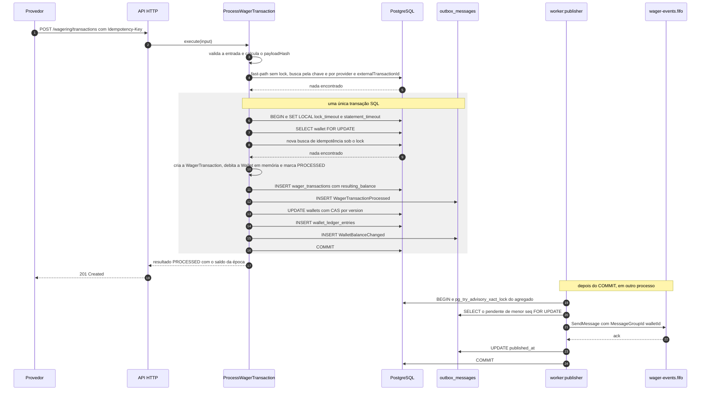

# Fluxo de uma BET pela API

Uma `BET` nova, com saldo suficiente, entrando por `POST /wagering/transactions`. Os passos e a ordem seguem o código.

## Onde cada passo está no código

| Passo | Arquivo e linha |
|---|---|
| 1 e 2 | `src/interfaces/http/wagering.controller.ts:41` e `:55` |
| 3 | `src/application/use-cases/process-wager-transaction.ts:97` |
| 4 e 5 | `src/application/use-cases/process-wager-transaction.ts:107` |
| 6 | `src/infrastructure/persistence/mikro-orm-unit-of-work.ts:26` a `:29` |
| 7 | `src/application/use-cases/process-wager-transaction.ts:152` |
| 8 e 9 | `src/application/use-cases/process-wager-transaction.ts:160` |
| 10 | `src/application/use-cases/process-wager-transaction.ts:174`, e `src/application/use-cases/apply-wager-rules.ts:87` e `:93` |
| 11 | `src/application/use-cases/apply-wager-rules.ts:94`, que chama o `persist` definido em `process-wager-transaction.ts:195` |
| 12 | `src/application/use-cases/apply-wager-rules.ts:95` |
| 13 | `src/application/use-cases/apply-wager-rules.ts:101` |
| 14 | `src/application/use-cases/apply-wager-rules.ts:102` |
| 15 | `src/application/use-cases/apply-wager-rules.ts:104` |
| 16 | fim do `transactional` em `src/infrastructure/persistence/mikro-orm-unit-of-work.ts:26` |
| 17 e 18 | `src/application/use-cases/process-wager-transaction.ts:212` |
| 19 | `src/infrastructure/persistence/postgres-outbox-publication-store.ts:60` |
| 20 | `src/infrastructure/persistence/postgres-outbox-publication-store.ts:67` a `:72` |
| 21 e 22 | `src/infrastructure/messaging/outbox-publisher.ts:99` |
| 23 | `src/infrastructure/messaging/outbox-publisher.ts:123` e `:124` |
| 24 | fim do `transactional` em `src/infrastructure/persistence/postgres-outbox-publication-store.ts` |

Esta referência é texto visível, e não um comentário HTML. O repositório não usa comentários HTML na documentação.

## Divergências em relação ao pedido

- **Participantes a mais:** além dos cinco pedidos, o diagrama tem o `worker:publisher` e a `wager-events.fifo`. Sem eles não dá para mostrar que o evento sai só depois do COMMIT.
- **O outbox não é um componente à parte.** É a tabela `outbox_messages` no mesmo PostgreSQL, escrita na mesma transação SQL. O participante separado deixa visível quais escritas são do outbox.
- **A ordem no código é outra.** O caso de uso não grava wallet, ledger, transação e outbox nessa ordem. A ordem real é:
  1. a transação;
  2. o `WagerTransactionProcessed` no outbox;
  3. o `UPDATE` da wallet com CAS;
  4. o lançamento no ledger;
  5. o `WalletBalanceChanged` no outbox.
  Como tudo está na mesma transação, a ordem não muda o que é commitado junto.
- **A primeira leitura fica fora da transação de escrita.** O fast-path de idempotência (passos 4 e 5) roda numa unidade de trabalho própria, sem lock, antes da transação de escrita.
- **O publisher envia um evento por agregado em cada ciclo.** O `WalletBalanceChanged` da mesma wallet sai num ciclo seguinte, com outra transação do publisher (ADR-0006). O diagrama mostra um ciclo.
